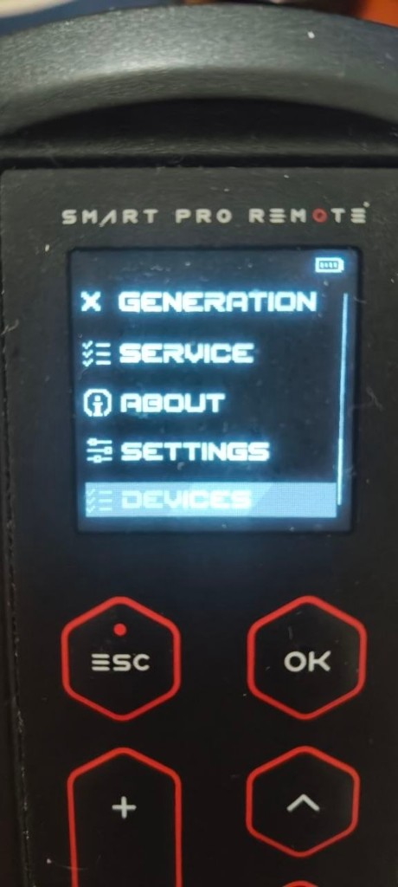
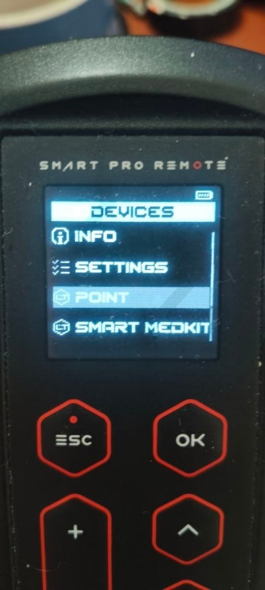
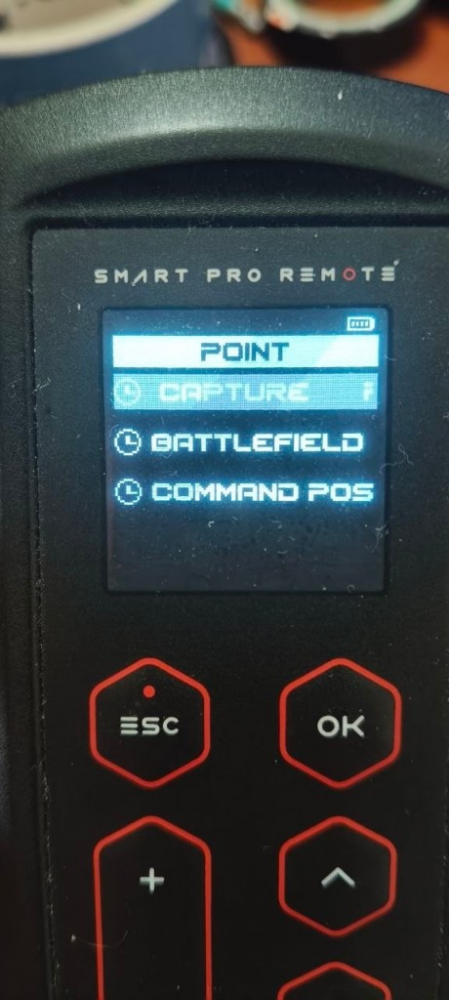
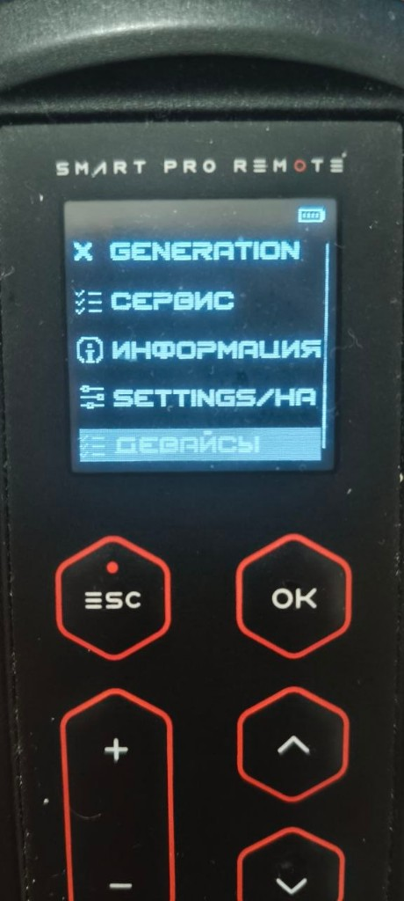
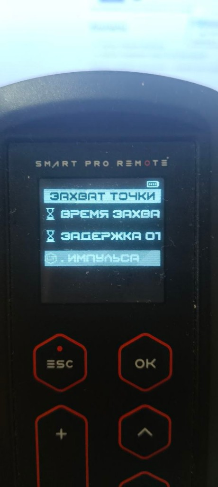
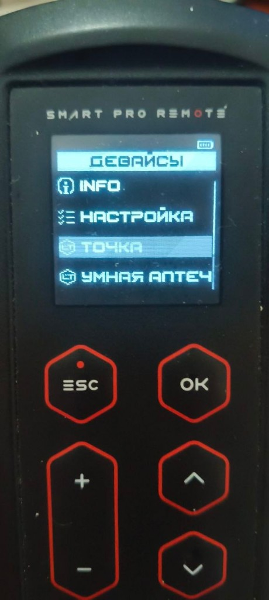

# Laserwar Smart Remote Pro V.1 — firmware mod

[Русская версия](README.md)

An unofficial mod of firmware v1.14 for the Laserwar Smart PRO Remote («Умный пульт Про V.1»), the lasertag setup remote. It adds a Devices section to the main menu, so the capture point, Smart medkit 2.0, Smart medic and command post can be set up from the remote, without a computer or the configurator.

Mod version: **1.04** (2026-10-27), based on the official firmware **v1.14**.

<p>
  
  
</p>

<details>
<summary>More menu photos (English and Russian UI)</summary>
<p>
  
  
  
  
</p>
</details>

## What is added

- **INFO** — mod version and contacts.
- **Settings** — point scenario (Point capture, Battlefield, Command post), start delay, sound language.
- **Point** — all parameters of Point capture, Battlefield point and Command post modes, negative and positive pulse commands (63 IR commands).
- **Smart medkit 2.0** — sets, hold time, hits, game mode (Health, Ammo, Energy with period and activation), round time, commands for every mode, emission time.
- **Smart medic** — sets, trigger time, hits, command.
- **Command post** — base capture, 2x2, medkit: emission power and interval, hits to capture, round time, self-restore, command interval and commands.

Full menu tree with value ranges: [docs/menu.md](docs/menu.md#english).

The stock functions of the remote are not changed. The Information screen shows the version as "v1.14-mod".

## Building

You need Python 3.10 or newer (https://www.python.org/downloads/), nothing else.

1. Download this repository: **Code → Download ZIP**, unpack it.
2. Download the official firmware v1.14: https://laserwar.ru/admin/uploads/adminFiles/Smart_PRO_Remote_v1_14.zip and put the zip into the repository folder. No need to unpack it.
3. Open a command prompt in that folder and run:

```
python build.py Smart_PRO_Remote_v1_14.zip
```

You get `Smart_PRO_Remote_v1.14_mod_1.04.bin`. Before writing it the script checks the new menu, which takes about a minute. `--quick` skips the check.

Only the official v1.14 file is accepted: with any other or damaged firmware the build stops.

## Prebuilt firmware

See [Releases](../../releases).

## Flashing the remote

1. Put the remote into update mode (Down + ESC, as for a regular Laserwar firmware update) and connect it over USB. It shows up as a USB drive.
2. Copy the `.bin` to the root of the drive.
3. Wait for the remote to restart. The Devices item appears in the main menu.

To go back, copy the official `.bin` the same way.

## For developers

- [docs/protocol.md](docs/protocol.md#english): how the remote writes settings over IR: frames, sessions, addresses and registers of the point, medkit, medic and command post.
- [docs/commands.md](docs/commands.md): bytes of every command in the menu, generated by `python tools/commands_md.py`.

## Disclaimer

This is an unofficial project, not affiliated with Laserwar. It is free and comes without any warranty; install at your own risk. The original firmware and the Laserwar trademark belong to their owner; this repository contains none of their files, the build uses the official file you download yourself.

The build scripts are MIT licensed, see [LICENSE](LICENSE).

## Contacts

- Author: Telegram [@spbvmz](https://t.me/spbvmz)
- Support group: https://t.me/lasertagpult

Questions, bugs and ideas: the group or [Issues](../../issues).
