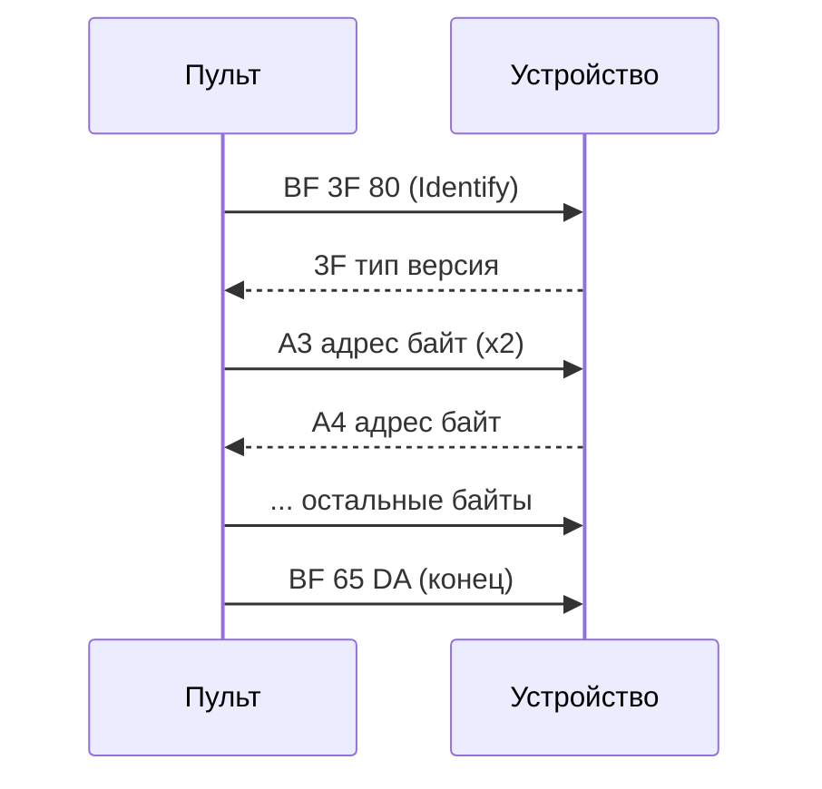

# Протокол записи настроек / Settings write protocol

[Русский](#русский) | [English](#english)

Полные списки байтов команд: [commands.md](commands.md).

## Русский

### ИК-кадр

Пульт передаёт настройки обычными 24-битными кадрами Miles, тем же передатчиком, что и команды. Кадр состоит из трёх байтов `b0 b1 b2`. Для кадров из двух байтов третий байт считается так:

- если `b0 >= 0xB0`, то `b2 = b0 XOR b1`;
- иначе `b2 = E8`.

Например, `BF 3F` уходит в эфир как `BF 3F 80` (`BF XOR 3F = 80`), а «Здоровье +10» (`80 0A`) — как `80 0A E8`.

Кадры идут с шагом 170 мс: 50 мс сам кадр и 120 мс пауза. Одна запись в устройство — одна сессия: пульт отправляет всю сессию по одному нажатию OK, остальное меню при этом работает.

### Точка: Захват точки, Battlefield, Пункт управления

Точка хранит настройки в 16-битных регистрах. Каждая запись — сессия из четырёх кадров:

| Кадр | Назначение |
|------|------------|
| `BF 3F 80` | Identify, вход в настройку |
| `C0+рег  младший  XOR` | младший байт в регистр `рег` |
| `C0+рег+1  старший  XOR` | старший байт в регистр `рег+1` |
| `FF 55 AA` | сохранить |

`C0+рег` — это `0xC0 OR рег`, третий байт считается по правилу выше (`b0 >= B0`, значит XOR).

Пример: «Время захвата» 30 с, регистр 0: `BF 3F 80`, `C0 1E DE`, `C1 00 C1`, `FF 55 AA`.

Команда импульса хранится в регистре как слово: младший байт — аргумент, старший — код команды. Пример: «Здоровье +10» (`80 0A`) в «Команду отр. импульса» (регистр 4): `BF 3F 80`, `C4 0A CE`, `C5 80 45`, `FF 55 AA`.

| Регистр | Параметр | Значение |
|---------|----------|----------|
| 0 | Захват точки: время захвата | секунды, от 10 |
| 2 | Захват точки: задержка отр. импульса | 0..9 |
| 4 | Захват точки: команда отр. импульса | команда |
| 6 | Battlefield: время захвата | секунды, от 10 |
| 8 | Battlefield: задержка отр. импульса | 0..9 |
| 10 | Battlefield: команда отр. импульса | команда |
| 12 | Battlefield: время удержания | секунды, от 10 |
| 14 | Battlefield: ускорение захвата | 1..999 |
| 16 | Battlefield: команда пол. импульса | команда |
| 18 | Battlefield: задержка пол. импульса | секунды |
| 20 | Battlefield: кол-во пол. импульсов | 1..30 |
| 22 | Пункт управления: очки прочности | 1..9999 |
| 24 | Пункт управления: владелец | 0 нейтральный, 1 красные, 2 синие, 3 жёлтые, 4 зелёные |
| 26 | Пункт управления: задержка восстановления | секунды |
| 28 | Пункт управления: скорость восстановления | 1..999 |
| 30 | Пункт управления: задержка отр. импульса | 0..9 |
| 32 | Пункт управления: команда отр. импульса | команда |
| 34 | Пункт управления: команда пол. импульса | команда |
| 36 | Пункт управления: задержка пол. импульса | секунды |
| 38 | Пункт управления: кол-во пол. импульсов | 1..30 |
| 40 | Язык звуков | 0 русский, 1 английский |
| 42 | Задержка старта | секунды, от 1 |
| 44 | Сценарий | 1 захват точки, 2 Battlefield, 3 пункт управления |

### Умная аптечка 2.0, Умный медик, Командный пункт

Эти устройства пишутся побайтово, по адресам:

| Кадр | Назначение |
|------|------------|
| `BF 3F 80` | Identify. Устройство отвечает `3F тип версия`: `21` аптечка, `20` медик, `12` командный пункт |
| (пропуск 170 мс) | пока устройство отвечает, кадры оно не принимает |
| `A3 адрес байт` | записать байт по адресу, каждый кадр отправляется дважды; ответ `A4 адрес байт` |
| `BF 65 DA` | конец настройки |

Кадры `A3` уходят как есть, без пересчёта третьего байта: третий байт — это записываемое значение.

- **Слово** (время раунда, период, количество выстрелов) пишется по двум адресам подряд, младший байт первым.
- **Команда** пишется по трём адресам: `c0`, `c1`, `c2`. Байт `c2` считается так же, как третий байт кадра: `c0 XOR c1`, если `c0 >= B0`, иначе `E8`.
- **«Выкл»** — 255 для байта, 65535 для слова. Исключение: время удержания аптечки, там «Выкл» = 0.

Пример: «Возрождение владельцев» (`B4 00 B4`) в «Команду при захвате» командного пункта (адрес 177 = `B1`):
`BF 3F 80`, пропуск, `A3 B1 B4` ×2, `A3 B2 00` ×2, `A3 B3 B4` ×2, `BF 65 DA`.

Пример: время раунда аптечки 1 ч (3600 = `0E10`), адрес 40 (`28`):
`BF 3F 80`, пропуск, `A3 28 10` ×2, `A3 29 0E` ×2, `BF 65 DA`.

**Умная аптечка 2.0**

| Адрес | Параметр | Значение |
|-------|----------|----------|
| 21..23 | команда Здоровье | команда |
| 24 | игровой режим | 0 Здоровье, 1 Боезапас, 2 Энергия |
| 25 | кол-во комплектов | 1..250, 255 выкл |
| 26 | попаданий на комплект | 1..250, 255 выкл |
| 37..39 | команда Боезапас | команда |
| 40..41 | время раунда | слово, секунды; 65535 без ограничений |
| 42 | время удержания | 1..240, 0 выкл |
| 43 | длительность излучения | 1..60 |
| 53..55 | команда Энергия | команда |
| 56..57 | период Энергии | слово, 1..1800 |
| 58 | активация Энергии | 0 нажатие, 1 автоматически |

**Умный медик**

| Адрес | Параметр | Значение |
|-------|----------|----------|
| 21 | кол-во комплектов | 1..254, 255 выкл |
| 22 | время срабатывания (удержание кнопки) | 0..240 |
| 23..25 | команда | команда |
| 26 | попаданий на комплект | 1..250, 255 выкл |

**Командный пункт**

| Адрес | Параметр | Значение |
|-------|----------|----------|
| 162..163 | интервал выполнения команды | слово, секунды; 65535 отключено |
| 164 | аптечка: время регенерации | 1..254, 255 выкл |
| 165 | захват: сила выброса | 1..100 |
| 166 | захват: время между выбросами | 10..254, 255 выкл |
| 167..168 | захват: выстрелов для захвата | слово, 1..10000 |
| 169..170 | захват: время раунда | слово, секунды (120..7200) |
| 171 | захват: самовосстановление | 1..254, 255 выкл |
| 172..173 | противостояние: кол-во боезапаса | слово, 1..10000 |
| 174..175 | противостояние: выстрелов для уничтожения | слово, 1..10000 |
| 176 | противостояние: самовосстановление | 1..254, 255 выкл |
| 177..179 | команда при захвате | команда |
| 180..182 | аптечка: команда | команда |
| 183..185 | противостояние: команда | команда |

## English

### IR frame

The remote sends settings as regular 24-bit Miles frames, with the same transmitter it uses for commands. A frame is three bytes `b0 b1 b2`. For two-byte frames the third byte is:

- `b2 = b0 XOR b1` if `b0 >= 0xB0`;
- `b2 = E8` otherwise.

So `BF 3F` goes on air as `BF 3F 80` (`BF XOR 3F = 80`), and Health +10 (`80 0A`) as `80 0A E8`.

Frames are 170 ms apart: 50 ms frame plus 120 ms gap. One write is one session, sent after a single OK press; the menu stays usable meanwhile.

### Control point: Point capture, Battlefield, Command post

The point keeps its settings in 16-bit registers. Every write is a four-frame session:

| Frame | Meaning |
|-------|---------|
| `BF 3F 80` | Identify, enter setup |
| `C0+reg  low  XOR` | low byte to register `reg` |
| `C0+reg+1  high  XOR` | high byte to register `reg+1` |
| `FF 55 AA` | save |

`C0+reg` is `0xC0 OR reg`; the third byte follows the rule above (`b0 >= B0`, so XOR).

Example: capture time 30 s, register 0: `BF 3F 80`, `C0 1E DE`, `C1 00 C1`, `FF 55 AA`.

A pulse command is stored as a word: low byte is the argument, high byte the command code. Example: Health +10 (`80 0A`) as the negative pulse command (register 4): `BF 3F 80`, `C4 0A CE`, `C5 80 45`, `FF 55 AA`.

| Register | Parameter | Value |
|----------|-----------|-------|
| 0 | Point capture: capture time | seconds, from 10 |
| 2 | Point capture: neg. pulse delay | 0..9 |
| 4 | Point capture: neg. pulse command | command |
| 6 | Battlefield: capture time | seconds, from 10 |
| 8 | Battlefield: neg. pulse delay | 0..9 |
| 10 | Battlefield: neg. pulse command | command |
| 12 | Battlefield: hold time | seconds, from 10 |
| 14 | Battlefield: capture boost | 1..999 |
| 16 | Battlefield: pos. pulse command | command |
| 18 | Battlefield: pos. pulse delay | seconds |
| 20 | Battlefield: pos. pulse count | 1..30 |
| 22 | Command post: hit points | 1..9999 |
| 24 | Command post: owner | 0 neutral, 1 red, 2 blue, 3 yellow, 4 green |
| 26 | Command post: restore delay | seconds |
| 28 | Command post: restore rate | 1..999 |
| 30 | Command post: neg. pulse delay | 0..9 |
| 32 | Command post: neg. pulse command | command |
| 34 | Command post: pos. pulse command | command |
| 36 | Command post: pos. pulse delay | seconds |
| 38 | Command post: pos. pulse count | 1..30 |
| 40 | Sound language | 0 Russian, 1 English |
| 42 | Start delay | seconds, from 1 |
| 44 | Scenario | 1 point capture, 2 Battlefield, 3 command post |

### Smart medkit 2.0, Smart medic, Command post device

These devices are written byte by byte, by address:

| Frame | Meaning |
|-------|---------|
| `BF 3F 80` | Identify. The device replies `3F type version`: `21` medkit, `20` medic, `12` command post |
| (170 ms skipped) | the device ignores frames while it replies |
| `A3 address byte` | write a byte, every frame is sent twice; reply `A4 address byte` |
| `BF 65 DA` | end of setup |

`A3` frames are sent as is: the third byte is the value being written, not a checksum.

- **Word** values (round time, period, hit counts) take two addresses, low byte first.
- **Commands** take three addresses: `c0`, `c1`, `c2`, where `c2` follows the frame rule: `c0 XOR c1` if `c0 >= B0`, else `E8`.
- **Off** is 255 for a byte and 65535 for a word. Exception: medkit hold time, where Off is 0.

Example: Respawn owners (`B4 00 B4`) as the command post capture command (address 177 = `B1`):
`BF 3F 80`, gap, `A3 B1 B4` x2, `A3 B2 00` x2, `A3 B3 B4` x2, `BF 65 DA`.

Example: medkit round time 1 h (3600 = `0E10`), address 40 (`28`):
`BF 3F 80`, gap, `A3 28 10` x2, `A3 29 0E` x2, `BF 65 DA`.

**Smart medkit 2.0**

| Address | Parameter | Value |
|---------|-----------|-------|
| 21..23 | Health command | command |
| 24 | game mode | 0 Health, 1 Ammo, 2 Energy |
| 25 | medkit sets | 1..250, 255 off |
| 26 | hits per set | 1..250, 255 off |
| 37..39 | Ammo command | command |
| 40..41 | round time | word, seconds; 65535 unlimited |
| 42 | hold time | 1..240, 0 off |
| 43 | emission time | 1..60 |
| 53..55 | Energy command | command |
| 56..57 | Energy period | word, 1..1800 |
| 58 | Energy activation | 0 button press, 1 automatic |

**Smart medic**

| Address | Parameter | Value |
|---------|-----------|-------|
| 21 | medkit sets | 1..254, 255 off |
| 22 | trigger time (button hold) | 0..240 |
| 23..25 | command | command |
| 26 | hits per set | 1..250, 255 off |

**Command post**

| Address | Parameter | Value |
|---------|-----------|-------|
| 162..163 | command interval | word, seconds; 65535 disabled |
| 164 | medkit: regen time | 1..254, 255 off |
| 165 | capture: emission power | 1..100 |
| 166 | capture: emission interval | 10..254, 255 off |
| 167..168 | capture: hits to capture | word, 1..10000 |
| 169..170 | capture: round time | word, seconds (120..7200) |
| 171 | capture: self-restore | 1..254, 255 off |
| 172..173 | 2x2: ammo count | word, 1..10000 |
| 174..175 | 2x2: hits to destroy | word, 1..10000 |
| 176 | 2x2: self-restore | 1..254, 255 off |
| 177..179 | capture command | command |
| 180..182 | medkit command | command |
| 183..185 | 2x2 command | command |
